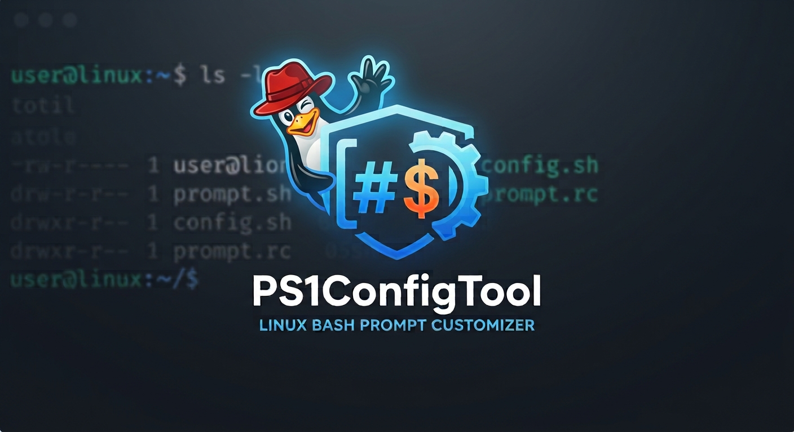

# PS1ConfigTool

<h4> A utility to change BASH prompt based on configurable profiles. </h4>

<h3>Project Status</h3>

  <!-- SHELLCHECK_COMPLIANCE_START --> <strong>Shellcheck Date Of Compliance:</strong> Pending Execution <!-- SHELLCHECK_COMPLIANCE_END -->

> [!NOTE]
> PS1ConfigTool is currently in active development.

> [!WARNING]
> This code is highly experiemental and has NOT been fully implemented or tested yet.

> [!IMPORTANT]
> Code is not considered stable yet, and still lacks most features.

